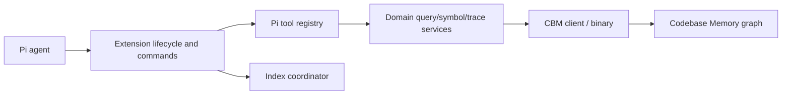
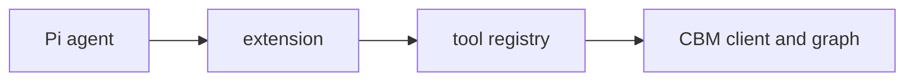
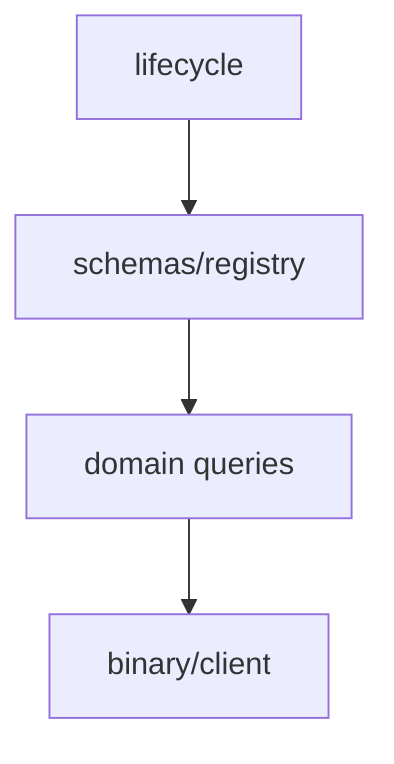
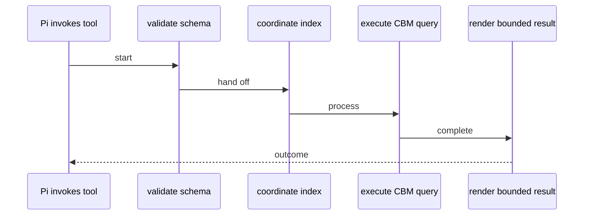

# Architecture

pi-cbm-md is a Pi extension that exposes Markdown-oriented Codebase Memory tools and coordinates indexing.

## Runtime topology

## Component map

## Primary workflow

## Solution

The extension installs into Pi and registers Markdown-oriented tools. Domain modules prepare tool inputs and render bounded results; the CBM client invokes the backing graph/binary; the index coordinator manages project indexing lifecycle.

## Code

Keep Pi-specific registration/rendering in `extension/` and `pi-tools/`; keep graph request semantics in `domain/`; keep process/protocol handling in `cbm/`. New tools should reuse schemas, registry, output limits, and coordinator signals rather than bypassing those boundaries.
